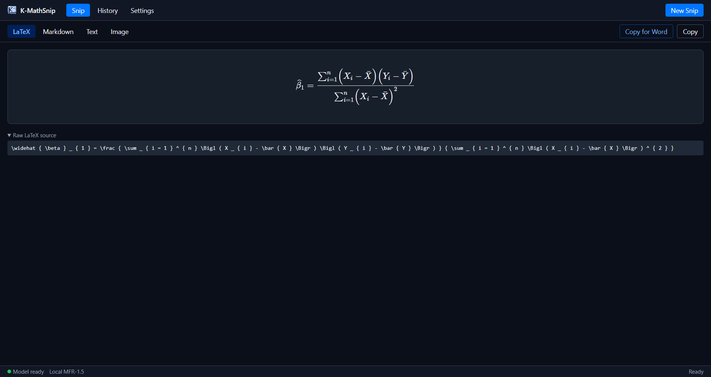
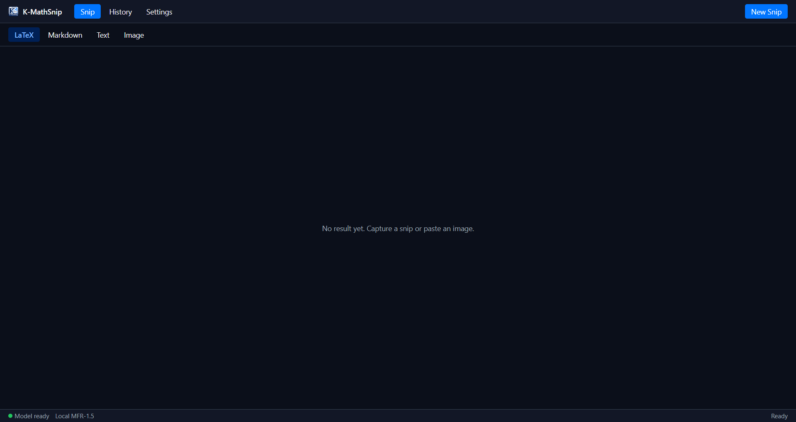
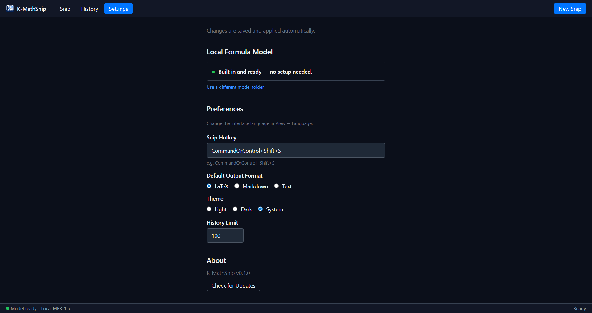

<p align="center">
  
</p>

<h1 align="center">K-MathSnip</h1>

<p align="center">
  Snip any equation on screen and get it back as a real, editable <strong>Word equation</strong>,
  LaTeX, or Markdown — fully offline, no account, no API key, nothing to configure.
</p>

---

## Installation

### Windows (recommended)

1. Open the [latest release](https://github.com/KevinLeve/k-mathsnip/releases/latest) and
   download **K-MathSnip Setup \*.exe** from **Assets**.
2. Run it. Windows SmartScreen may show "Windows protected your PC" because the build isn't
   code-signed yet — click **More info → Run anyway**.
3. That's it. The formula recognition model ships inside the installer — there is no separate
   download step, no account, and no API key to configure.

A **portable** build (`K-MathSnip *.exe`, no installation) is also attached to each release.

### Build from source (optional)

Requires Node.js 22.12 or later and npm.

```bash
git clone https://github.com/KevinLeve/k-mathsnip.git
cd k-mathsnip
npm install
npm run dev
npm run check      # TypeScript, ESLint, regression tests, production build
npm run package
```

## Getting started

1. Press the global snip hotkey (**Ctrl+Shift+S** by default) or click **New Snip**.
2. Drag a box around any equation on screen.
3. K-MathSnip recognizes it — the formula model is already loaded and ready, no setup wait on
   first launch.
4. A real, editable Word equation is **copied to your clipboard automatically**. Switch to Word
   and press **Ctrl+V** — that's the whole workflow.
5. Need LaTeX or Markdown instead? Switch tabs in the result window and click **Copy**.

Recognition runs entirely on your CPU in a local background process — no cloud, no network
request, nothing leaves your machine.

<div align="center">
  
</div>

MFR recognizes **formula crops** — snip a single equation with a small margin around it for the
most reliable result. It does not parse mixed text/formula pages, tables, or full document
layout. Complex layouts, handwriting, and unusual screenshots may still need a manual check:
every recognized result shows its raw LaTeX source so you can verify it before relying on it.

## Copy for Word

**Copy for Word** is the feature this app is built around: it converts the recognized LaTeX into
[Presentation MathML](https://www.w3.org/TR/MathML3/) and writes it to the clipboard under the
format Word itself uses when you copy a native equation — so pasting (**Ctrl+V**) into Word
creates a real, fully editable equation object, not a picture and not a block of LaTeX text.

This happens **automatically after every snip** when the recognized formula supports it. If a
particular equation is too complex to convert safely, K-MathSnip falls back to copying it as
plain LaTeX instead and tells you why — it never guesses or ships something silently wrong.

<div align="center">
  
</div>

### Converting to a real MathType object

If [MathType](https://www.wiris.com/en/mathtype/) itself is installed, you can turn the pasted
equation into an actual MathType OLE object (not just a Word-native equation) with one shortcut:

1. Paste the equation into Word as usual (**Ctrl+V**).
2. Press **Ctrl+Shift+M**.

The equation is silently converted in place — no dialogs, no manual steps. This works via a small
Word add-in (`KMathSnip-MathType.dotm`) that K-MathSnip installs automatically into Word's
add-in folder on first launch; it only activates MathType's own built-in conversion command, it
does not implement or guess at MathType's file format itself.

**One-time setup:** the first time you use it, open MathType's **Convert Equations** dialog once
(MathType tab in Word → **Convert Equations**), enable **"Word 2007 and later (OMML) equations"**
as a source type, set the target to **"MathType equations (OLE objects)"**, and leave **"Prompt
before converting each equation"** unchecked. MathType remembers these settings afterward, so
every future **Ctrl+Shift+M** press just works.

## Viewing results

After recognition, results appear in four tabs:

| Tab          | Description                                                  |
| ------------ | -------------------------------------------------------------|
| **LaTeX**    | Extracted math rendered via KaTeX, with copyable raw source. |
| **Markdown** | The result wrapped as display math.                          |
| **Text**     | Plain LaTeX source, no formatting.                            |
| **Image**    | The original captured screenshot.                            |

**Raw LaTeX source** is expanded by default for each new result — click its heading to collapse
or expand it. **Copy for Word** and **Copy** (the active tab's format) are both available on
every tab.

## Settings

| Setting        | Default          | Description                                                 |
| -------------- | ----------------- | ------------------------------------------------------------ |
| Formula model  | Built in          | Bundled with the install; point it at a different folder only if you need to. |
| Snip Hotkey    | `Ctrl+Shift+S`   | Global shortcut for screen capture.                           |
| Default Output | LaTeX              | Format used by the plain-text **Copy** fallback.              |
| Theme          | System              | Light / Dark / System.                                        |
| History Limit  | 100                 | Max saved recognitions (10–500).                             |
| Check for Updates | —                | Manual check, plus a quiet automatic check on startup against this repository's releases. |

Settings save automatically and take effect immediately or after a short pause in typing.

<div align="center">
  
</div>

## History

Click **History** in the toolbar to browse past recognitions. Each entry shows a thumbnail,
timestamp, and preview. Use the search bar to filter, or click an entry to re-open its result.

## System tray

Closing the window minimizes to tray. Right-click the tray icon for:

- **Snip** — start capture
- **Open Window** — show main window
- **Settings** — open settings
- **Quit** — exit

## Keyboard shortcuts

| Shortcut         | Action                      |
| ----------------- | ---------------------------- |
| `Ctrl+Shift+S`   | Screen snip (global)         |
| `Ctrl+V`         | Paste image for recognition  |
| `Escape`         | Cancel snip                  |
| `Ctrl+Shift+M`   | In Word: convert pasted equation to a MathType object (requires MathType) |

## Credits

K-MathSnip is built on the open-source [OpenMathpix](https://github.com/JhuoW/OpenMathpix)
project by **JhuoW** (MIT License) — the screen-capture engine and overall application
architecture originate there. Formula recognition uses
[Pix2Text MFR-1.5](https://huggingface.co/breezedeus/pix2text-mfr-1.5) by **BreezeDeus**
(MIT License). Full license text and attribution: [THIRD_PARTY_NOTICES.md](THIRD_PARTY_NOTICES.md).

## License

MIT
